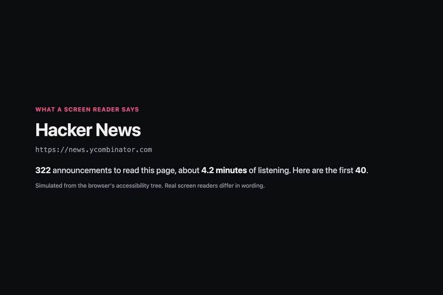

# hearsite

Hear your website the way a screen reader user does.

```bash
npx hearsite https://example.com
```

One command turns a URL into a narrated video: the page on screen, an outline moving to each element in reading order, and a voice saying what a screen reader would announce, with captions. It ends with a list of what a listener runs into, such as images with no description and buttons with no name.



*The Hacker News front page: 322 announcements, about 4 minutes of listening. The GIF is silent; [watch it with sound](docs/demo.mp4).*

## Why

Most people who build websites have never listened to one. A score of 87 is easy to ignore. Hearing "link, link, button, image, image" on a page you made is not.

## What you get

- **A video** (`hearsite.mp4`) with voice and captions, ready to share with a team or a client.
- **A transcript** (`hearsite.txt`) with the complete reading order of the page and every problem marked.
- **A summary** of what a listener runs into:
  - images with no description
  - links, buttons and form fields with no name
  - empty headings and skipped heading levels
  - a missing page title, level 1 heading or main landmark
  - how many announcements, and how many minutes, it takes to hear the whole page

Everything runs on your machine. Nothing is uploaded.

## Read this first: it is a simulation

hearsite reads the accessibility tree that Chromium builds for the page, which is the same information a screen reader receives, and announces it in a common style. It is not VoiceOver, NVDA, JAWS or TalkBack:

- Real screen readers differ from each other in wording, order and what they skip.
- Real users rarely listen top to bottom. They jump between headings, landmarks and links.
- It reads the page as loaded. It does not open menus, submit forms or follow focus.

Use it to notice problems and to make them felt. Test with a real screen reader, and with people who use one, before calling a page accessible.

## Requirements

- Node.js 20 or newer
- ffmpeg (`brew install ffmpeg`, `apt install ffmpeg`, `winget install ffmpeg`)
- Chromium for Playwright: `npx playwright install chromium`
- A voice: macOS uses the built-in `say`; on Linux install `espeak-ng`. Without one, the video has captions only.

## Usage

```bash
hearsite <url or html file> [options]
```

```bash
# A local page while you develop
hearsite localhost:3000

# Only the transcript and the summary
hearsite example.com --no-video

# The first 100 announcements, on a phone-sized screen
hearsite example.com -n 100 --mobile

# Slower speech and a different voice (macOS)
hearsite example.com --rate 170 --voice Samantha
```

| Option | Meaning | Default |
| --- | --- | --- |
| `-o, --out <file>` | Video to write; the transcript goes next to it | `hearsite.mp4` |
| `--no-video` | Write only the transcript | off |
| `-n, --max <n>` | Most announcements to put in the video | `60` |
| `--start <n>` | Skip this many announcements first | `0` |
| `--wait <ms>` | Pause after the page loads | `800` |
| `--rate <wpm>` | Speaking speed in words per minute | `200` |
| `--voice <name>` | Voice to use (macOS: `say -v ?` lists them) | system voice |
| `--silent` | Captions only, no voice | off |
| `--width`, `--height <px>` | Viewport size | `1280` x `720` |
| `--mobile` | Phone viewport, 390 wide with touch | off |
| `--scale <n>` | Pixel density; `2` gives a sharper video | `1` |

## Use it from Claude Code

This repo is also a Claude Code plugin with a skill that teaches Claude when and how to run `hearsite`.

```
/plugin install hearsite --marketplace Suryansh-Codes2209/hearsite
```

Then ask Claude for things like "what does a screen reader say on localhost:3000, and fix what's wrong".

For other agents that read skills, copy the `skills/hearsite` folder into the agent's skills directory.

## How it works

1. Playwright opens the page in headless Chromium.
2. The full accessibility tree is read through the Chrome DevTools Protocol.
3. The tree is walked in order and turned into announcements: "heading level 2, Pricing", "link, Sign in", "image" for a picture with no description.
4. For each announcement the element is scrolled into view, outlined and screenshotted, and the text is spoken to an audio file.
5. ffmpeg joins the pictures and the audio, holding each picture for exactly as long as its speech.

## Development

```bash
npm install
npx playwright install chromium
npm test
```

The test films a local page with known problems and checks the reading order, the findings and the video.

## License

MIT
